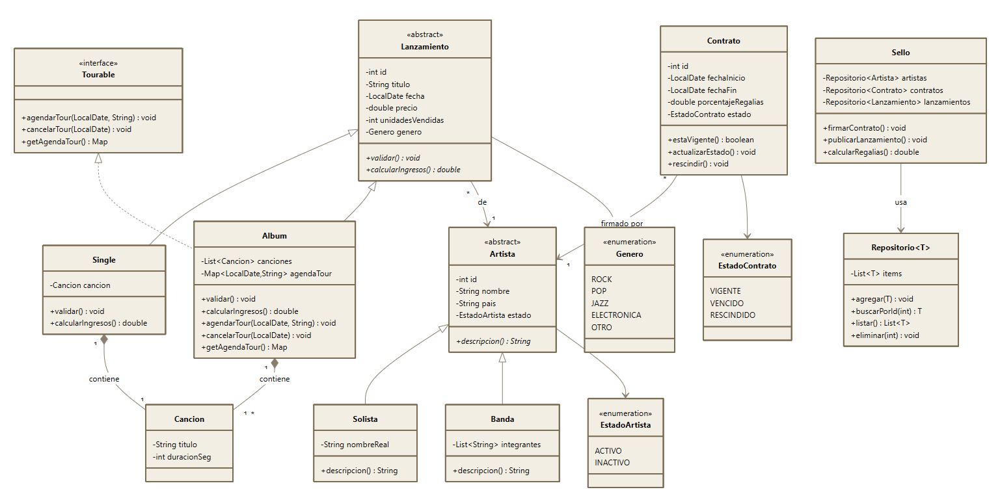

# Gestión Discográfica

Trabajo Práctico Final de **Programación II** — UTN FRMDP.

Sistema de consola para administrar un sello discográfico: alta y consulta de artistas (solistas y bandas), firma y seguimiento de contratos, publicación de lanzamientos (singles y álbumes) y cálculo de regalías. Los datos principales se persisten en MySQL mediante JDBC.

## Diagrama UML



> El diagrama original está en [`docs/Programacion II TP FINAL.docx`](docs/Programacion%20II%20TP%20FINAL.docx).

## Tecnologías

- Java 21
- Maven
- MySQL 8+ con el driver `mysql-connector-j` 9.6.0
- Git / GitHub

## Arquitectura

El sistema está organizado en capas. Cada capa solo conoce a la siguiente:

```
Menús (consola)  →  Sello  →  Gestores  →  DAOs (JDBC)  →  MySQL
                       └────→  Repositorio<T> (memoria)
```

| Capa | Responsabilidad |
|---|---|
| **Menús** | Muestran opciones, leen datos con `ConsolaUtil` y muestran resultados o errores. Solo hablan con `Sello`. |
| **Sello** | Fachada del sistema. Resuelve las operaciones que involucran varias entidades: firmar contratos, publicar lanzamientos y calcular regalías. |
| **Gestores** | Reglas de negocio de una sola entidad (validar antes de dar de alta o modificar). `Gestor<T>` es una clase genérica abstracta. |
| **DAOs** | Acceso a la base de datos con JDBC (`PreparedStatement`, try-with-resources). Implementan `Dao<T>`. |
| **Repositorio\<T\>** | Clase genérica para los datos que se manejan en memoria. |

`Main` es el único lugar donde se crean los objetos: arma los DAOs, los gestores y el `Sello`, y se los pasa por constructor a quien los necesita (inyección de dependencias).

## Estructura del proyecto

```
gestion_discografica/
├── docs/                    UML y consigna del TP
├── sql/
│   ├── schema.sql           Base de datos, usuario y tablas
│   └── datos.sql            Datos de prueba
└── src/main/java/
    ├── app/                 Main
    ├── config/              Conexion (datos de conexión JDBC)
    ├── dao/                 ArtistaDao, ContratoDao, LanzamientoDao
    ├── enums/               EstadoArtista, EstadoContrato, Genero
    ├── excepciones/         Excepciones propias del sistema
    ├── gestores/            Gestor<T>, GestorArtista, GestorContrato, GestorLanzamiento, Sello
    ├── interfaces/          Dao<T>, Identificable, Tourable
    ├── menu/                Menu (abstracta) y submenús
    ├── modelo/              Artista, Solista, Banda, Lanzamiento, Single, Album, Cancion, Contrato
    ├── repositorio/         Repositorio<T>
    └── util/                ConsolaUtil
```

## Modelo de dominio

- **Artista** (abstracta): `Solista` (con nombre real) y `Banda` (con lista de integrantes).
- **Lanzamiento** (abstracta): `Single` (una canción) y `Album` (varias canciones). Cada tipo define su propia validación y su cálculo de ingresos.
- **Cancion**: forma parte de un lanzamiento (composición), no existe por separado.
- **Contrato**: vincula un artista con el sello por un período y un porcentaje de regalías. Su estado puede ser `VIGENTE`, `VENCIDO` o `RESCINDIDO`.
- **Tourable**: interfaz para lo que puede salir de gira (agendar y cancelar fechas).

## Base de datos

Las tablas se persisten con JDBC:

| Tabla | Contenido |
|---|---|
| `artista` | Solistas y bandas en una sola tabla, distinguidos por la columna `tipo` |
| `banda_integrante` | Integrantes de cada banda |
| `contrato` | Contratos de cada artista |
| `lanzamiento` | Singles y álbumes en una sola tabla, distinguidos por la columna `tipo` |
| `cancion` | Canciones de cada lanzamiento |

Al borrar un lanzamiento o una banda se borran sus canciones o integrantes (`ON DELETE CASCADE`). Un artista con contratos o lanzamientos no se puede borrar: se lo da de baja pasándolo a `INACTIVO`.

### Crear la base

Desde la raíz del proyecto, con un usuario administrador de MySQL:

```bash
mysql -u root -p < sql/schema.sql
```

Para cargar los datos de prueba (Andrés Calamaro, Paul McCartney, Adele, The Rolling Stones y Pearl Jam):

```bash
mysql -u root -p < sql/datos.sql
```

`schema.sql` crea también el usuario que usa la aplicación. Sus credenciales están en [`config/Conexion.java`](src/main/java/config/Conexion.java) y tienen que coincidir con las del script.

## Cómo ejecutar

> Para que la limpieza de pantalla del menú funcione, hay que ejecutar el programa desde una terminal real (o la pestaña *Terminal* de IntelliJ), no desde la consola de *Run*.

**Con Maven:**

```bash
mvn -q compile exec:java -Dexec.mainClass=app.Main
```

**Sin Maven** (usando el driver que IntelliJ descarga en `~/.m2`):

```bash
javac -d out $(find src/main/java -name "*.java")
```

```bash
java -cp out:$HOME/.m2/repository/com/mysql/mysql-connector-j/9.6.0/mysql-connector-j-9.6.0.jar app.Main
```

En Windows, el separador del classpath es `;` en lugar de `:`.

## Requisitos de la consigna

| # | Requisito | Dónde se cumple |
|---|---|---|
| 1 | Diagrama UML | [`docs/uml.png`](docs/uml.png) |
| 2 | Herencia, polimorfismo, abstracción y encapsulamiento | `Artista` → `Solista`/`Banda`, `Lanzamiento` → `Single`/`Album`, `Menu` → submenús; atributos privados con setters que validan |
| 3 | Mínimo 5 clases propias | Paquete `modelo`, gestores, `Sello`, menús |
| 4 | Clase abstracta e interfaz implementadas | `Artista`, `Lanzamiento`, `Menu`, `Gestor<T>` / `Dao<T>`, `Identificable`, `Tourable` |
| 5 | Listas o colecciones | `Banda.integrantes`, canciones de `Album`, `Repositorio<T>` |
| 6 | Al menos 3 excepciones propias | Paquete `excepciones` |
| 7 | Clase genérica | `Gestor<T extends Identificable>`, `Repositorio<T extends Identificable>` |
| 8 | Persistencia JDBC en las clases principales | `ArtistaDao`, `ContratoDao`, `LanzamientoDao` |
| 9 | Git y GitHub | Este repositorio |

## Flujo de trabajo con Git

- `main`: versión estable que se entrega.
- `dev`: integración. Los cambios llegan por pull request.
- Una rama por integrante o por tarea, que se integra a `dev` mediante pull request.

## Integrantes

| Integrante | Responsabilidades |
|---|---|
| Hernán Flecchia | `Repositorio<T>`, `Sello`, DAOs con JDBC, `schema.sql`, estructura del repositorio, `Main`, menús y `ConsolaUtil` |
| _completar_ | _completar_ |
| _completar_ | _completar_ |

Las notas de desarrollo que estaban antes en este README se movieron a [`docs/notas-desarrollo.md`](docs/notas-desarrollo.md).
